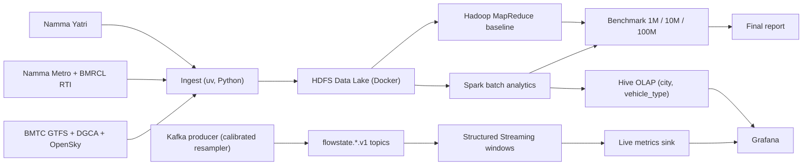

# Architecture

FlowState is a Lambda pipeline on Indian urban mobility data. CityPulse (EU FP7, 2014–2017) is the reference architecture, not a code donor. Decisions: [ADR-0001](adr/0001-citypulse-reference-architecture-only.md), [ADR-0002](adr/0002-lambda-pipeline-kafka-spark-hdfs-hive.md).

CityPulse → FlowState component map (Kafka topics, windows, Hive partitions, dashboards): **[ADR-0002](adr/0002-lambda-pipeline-kafka-spark-hdfs-hive.md)**. Repo ranking and reading list: [agents/citypulse.md](agents/citypulse.md).

## Runtime

Compose cluster + host uv: [ADR-0003](adr/0003-compose-cluster-host-uv.md). Operator detail: [dev-modes.md](dev-modes.md).

## Open infra (deliberate)

MapReduce submit is `make yarn-probe` on the bde2020 ResourceManager ([ADR-0015](adr/0015-yarn-mapreduce-submit.md)). The MapReduce analytics jobs are #24. See [team.md](team.md) and [agents/spikes.md](agents/spikes.md).

The Hive warehouse directory is `hdfs://namenode:9000/user/hive/warehouse`. Derby is the metastore database.

Staged ride-hail parquet on the lake is `hdfs://namenode:9000/lake/namma_yatri/` (`make lake`). That is the observed clock. Amplify writes `hdfs://namenode:9000/lake/rides_amplified/` beside it. Spark findings and MapReduce benches read the amplified directory. Record: [work-plan.md](work-plan.md).
