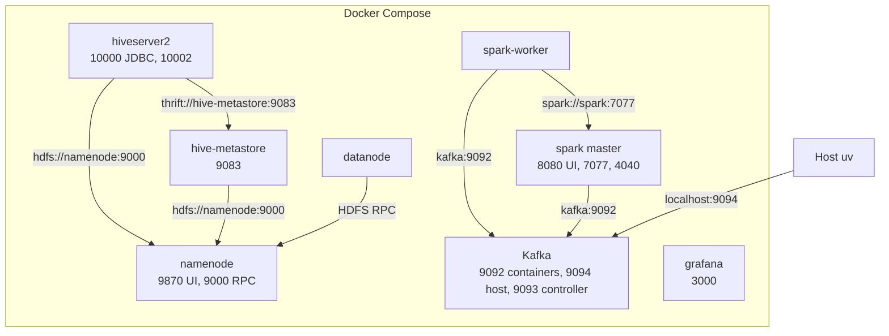

# Runtime

Spark, Hadoop, Hive, Kafka, and Grafana run **only** in Docker Compose. Do not install Hadoop/Spark/JDK on the host.

| Piece | Where it runs | How |
|---|---|---|
| Ingest, amplify, tests, lint | Host `uv` | `make setup`, `make ingest`, `make test` |
| Kafka producer | Host `uv` | `make stream-produce` → `localhost:9094` |
| Spark batch + Structured Streaming | Compose `spark` + `spark-worker` | `make hotspots`, `make stream-consume` |
| MapReduce compile | `maven:3.9-eclipse-temurin-8` one-shot | `make mr-package` |
| MapReduce submit | Hadoop images (YARN spike) | TBD with the YARN spike |
| Hive DDL | `hiveserver2` | `make hive-ddl` |

`make setup` / `python -m flowstate.config --check` prints data dir, Kafka bootstrap, Spark master URL.

## Kafka listeners

Host producer must **not** use `kafka:9092`. That hostname only resolves inside Compose.

- Containers → `kafka:9092`
- Host → `localhost:9094` (`FLOWSTATE_KAFKA_BOOTSTRAP_SERVERS`)

Spark services set `FLOWSTATE_DATA_DIR=/opt/data` and `FLOWSTATE_KAFKA_BOOTSTRAP_SERVERS=kafka:9092` so jobs inside the network see the mount and the internal listener.

## Compose links

Host `uv` is outside Compose. It writes `./data` and publishes to Kafka.



Bind mounts, not network links: `./data` is `/opt/data` in the Spark master and the worker. `./data/lake` is `/mnt/lake` on the namenode. `./src` is `/opt/src` in Spark and in HiveServer2.

Grafana listens on host port 3000. It has no warehouse connection and no stream connection yet. Hive warehouse files are on HDFS at `hdfs://namenode:9000/user/hive/warehouse`. Derby is the metastore database.

Port 9092 is published on loopback. Kafka advertises it as `kafka:9092`. Use that name only inside Compose. The host producer uses `localhost:9094`. Namenode 9870/9000 also bind to `127.0.0.1`. HDFS permissions are off, so those ports must not listen on the LAN.

## Compose services

| Service | Ports | Role |
|---|---|---|
| namenode | 127.0.0.1:9870 UI, 127.0.0.1:9000 RPC | HDFS. Loopback only. Permissions are off |
| datanode | — | HDFS blocks |
| kafka | 127.0.0.1:9092 containers, 127.0.0.1:9094 host | KRaft, no ZooKeeper |
| spark | 8080 UI, 7077, 4040 | Spark master |
| spark-worker | — | Spark worker |
| hive-metastore | 9083 | Derby metastore database |
| hiveserver2 | 10000, 10002 | beeline / JDBC |
| grafana | 3000 | dashboards |

Tags are pinned in `docker-compose.yml`. The Hive warehouse directory is `hdfs://namenode:9000/user/hive/warehouse`. MapReduce on YARN is an open spike. A `hive_metastore` volume from before that URI keeps database `default` on local disk. Remove the volume and start Hive again.

## Data mount

Host ingest writes `./data/...`. Spark containers still mount that at `/opt/data`. After #7, batch jobs read `hdfs://namenode:9000/lake/...`. Keep the mount until #22 moves the stream-sink onto HDFS. Do not treat `/opt/data` as the batch input.

## Ride-hail lake

`make lake` puts the staged ride-hail parquet on HDFS. Run `make up` first so the namenode and the datanode are up. A login shell in the namenode does not see `hdfs`. The binary is `/opt/hadoop-3.2.1/bin/hdfs`.

```bash
docker compose --env-file infra/kafka/cluster.env exec -T namenode \
  /opt/hadoop-3.2.1/bin/hdfs dfs -ls /lake/namma_yatri
```

The lake directory is `hdfs://namenode:9000/lake/namma_yatri/`. MapReduce submit reads that directory. Amplify writes `hdfs://namenode:9000/lake/rides_amplified/` beside it. `./data/lake` is the copy-in mount (`/mnt/lake` on the namenode). It is not the lake. `make lake` removes the ride-hail copy-in after HDFS has the files. `data/lake/hive-load/` stays. The host staged files stay in `data/staged/namma_yatri/`.
