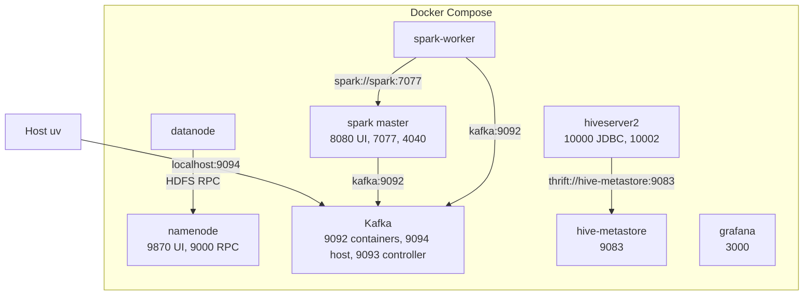

# Runtime

Spark, Hadoop, Hive, Kafka, and Grafana run **only** in Docker Compose. Do not install Hadoop/Spark/JDK on the host.

| Piece | Where it runs | How |
|---|---|---|
| Ingest, amplify, tests, lint | Host `uv` | `make setup`, `make ingest`, `make test` |
| Kafka producer | Host `uv` | `make stream-produce` → `localhost:9094` |
| Spark batch + Structured Streaming | Compose `spark` + `spark-worker` | `make hotspots`, `make stream-consume` |
| MapReduce compile | `maven:3.9-eclipse-temurin-8` one-shot | `make mr-package` |
| MapReduce submit | Hadoop images (YARN spike) | TBD with the YARN spike |
| Hive DDL | `hiveserver2` | `make hive-ddl` |

`make setup` / `python -m flowstate.config --check` prints data dir, Kafka bootstrap, Spark master URL.

## Kafka listeners

Host producer must **not** use `kafka:9092`. That hostname only resolves inside Compose.

- Containers → `kafka:9092`
- Host → `localhost:9094` (`FLOWSTATE_KAFKA_BOOTSTRAP_SERVERS`)

Spark services set `FLOWSTATE_DATA_DIR=/opt/data` and `FLOWSTATE_KAFKA_BOOTSTRAP_SERVERS=kafka:9092` so jobs inside the network see the mount and the internal listener.

## Compose links

Host `uv` is outside Compose. It writes `./data` and publishes to Kafka.

Bind mounts, not network links: `./data` is `/opt/data` in the Spark master and the worker. `./data/lake` is `/mnt/lake` on the namenode. `./src` is `/opt/src` in Spark and in HiveServer2.

Grafana listens on host port 3000. It has no warehouse connection and no stream connection yet. Hive does not read HDFS yet. The warehouse path in `infra/hive/hive-site.xml` is local.

Port 9092 is published on the host, but Kafka advertises it as `kafka:9092`. Use that name only inside Compose. The host producer uses `localhost:9094`.

## Compose services

| Service | Ports | Role |
|---|---|---|
| namenode | 9870 UI, 9000 RPC | HDFS |
| datanode | — | HDFS blocks |
| kafka | 9092, 9094 | KRaft, no ZooKeeper |
| spark | 8080 UI, 7077, 4040 | Spark master |
| spark-worker | — | Spark worker |
| hive-metastore | 9083 | Derby for now |
| hiveserver2 | 10000, 10002 | beeline / JDBC |
| grafana | 3000 | dashboards |

Tags are pinned in `docker-compose.yml`. Hive↔HDFS is a spike, not done: `infra/hive/hive-site.xml` still uses a local warehouse path on purpose.

## Data mount

Host ingest writes `./data/...`. Spark containers mount that at `/opt/data`. Same files; do not duplicate job code for "host Spark".
