# Bengaluru resampler evaluation (v1)

Hold-out scores, selection decisions, and the 1,000,000-row reconstruction for later developers. Protocol is [resampling-plan.md](resampling-plan.md) §10 and [ADR-0010](adr/0010-bengaluru-calibrated-resampler.md). Thin-window reconstruction is [ADR-0013](adr/0013-amplify-thins-the-alignment-window.md).

This report is the evidence for GitHub #34 (T32). Live wall-clock emit is #39. Bus boarding values as `FLOWSTATE_` settings are #40 (ADR-0012, not yet filed).

**City.** The run uses the registered Bengaluru `CityProfile`. Builders read a `CitySpec`. They do not hard-code Bengaluru literals. Numbers below are from this city's staged tables on 2026-10-22.

**Not a forecast.** Amplify is a thin reconstruction of the alignment window. Hold-out CRPS is the only scored forecast test. It applies to Layer 1 daily clocks only.

## 1. How to reproduce

Staged sources must already exist. Do not run `make ingest`.

```bash
make evaluate                 # writes src/flowstate/benchmarks/results/resampler-evaluation.json
make amplify ROWS=1000000 SEED=42
uv run pytest -q
uv run ruff check src tests
```

Frozen JSON is the committed score record. Figures in [assets/resampler/](assets/resampler/) come from that JSON plus one `SEED=42` corpus. Re-run `make amplify` only if you need a new part hash. The committed JSON does not change unless the clocks or the protocol change.

| Artifact                 | Path                                                         |
| ------------------------ | ------------------------------------------------------------ |
| Frozen hold-out record   | `src/flowstate/benchmarks/results/resampler-evaluation.json` |
| Model bundle (local run) | `data/staged/rides_amplified/bundle.json`                    |
| Corpus + manifest        | `data/staged/rides_amplified/` (gitignored)                  |
| Package                  | `src/flowstate/resample/`                                    |
| Tests                    | `tests/test_resample.py`, `tests/resample_fixtures.py`       |

## 2. What was scored

Fit window: 2024-10-26 through 2025-07-31. Hold-out: 2025-08-01 through 2025-09-30 (the station-hour service spans). A Yellow Line opening on 2025-08-11 splits that hold-out. After selection, clocks refit through 2026-04-15. Hold-out scores stay frozen.

Primary score: CRPS (lower is better). Point baselines score as MAE. Keep aviation terms only if held-out CRPS improves by at least 5 percent over the best simple baseline, without a material drop in 90 percent interval coverage. Date-block bootstrap: 7-day blocks, 1000 draws, seed 20200101.

Missing dates drop out of every fit and score. They are not zero-filled.

| Series                          | Train dates | Hold-out dates scored |
| ------------------------------- | ----------- | --------------------- |
| Ride-hail (`done_ride`, Normal) | 279         | 61                    |
| Metro (tracker daily total)     | 218         | 41                    |

Ride-hail and metro share 218 dates for the copula. Aviation daily NB2 is a covariate candidate, not a scored forecast of flights.

Tracks B–D in the plan (metro hour hold-out, ride-hail hour stability) are **not** scored here. See §8.

## 3. Layer 1: hold-out clocks

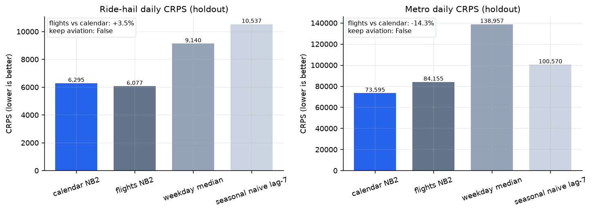

Calendar NB2 beats weekday-median and lag-7 naive on both modes.

**Flight covariates are untested since 2026-10-27.** The flights rows below come from an earlier run that counted thin OpenSky windows as low days. A thin window is a fetch gap, not a low day (ADR-0017). With the gap rule applied, the committed record has too few shared flight and mode dates to run the test: fit 42 (ride-hail) and 38 (metro), 60 needed. `keep_aviation_terms` stays false, and the record says why. The tables and charts below are history. They are not evidence for or against flight terms.

### 3.1 Ride-hail daily `done_ride`

| Spec                 | CRPS    | MAE     | log score | 90% coverage |
| -------------------- | ------- | ------- | --------- | ------------ |
| Calendar NB2         | 6295.4  | 8505.0  | 10.883    | 95.1%        |
| Flights NB2          | 6077.1  | 8157.5  | 10.868    | 90.2%        |
| Weekday median       | 9140.2  | 9140.2  | —         | 0%           |
| Seasonal naive lag-7 | 10537.2 | 10537.2 | —         | 0%           |

Flights vs calendar: **+3.47%** CRPS (bootstrap CI −0.72% to +8.00%). Coverage 90.2% vs 95.1%. **Keep aviation terms: false.**

Final ride-hail NB2 dispersion `phi` after the full-window refit: 97.50.

### 3.2 Metro daily tracker total

| Spec                 | CRPS     | MAE      | log score | 90% coverage |
| -------------------- | -------- | -------- | --------- | ------------ |
| Calendar NB2         | 73594.9  | 102978.9 | 13.519    | 82.9%        |
| Flights NB2          | 84154.6  | 114881.0 | 13.908    | 61.0%        |
| Weekday median       | 138956.9 | 138956.9 | —         | 0%           |
| Seasonal naive lag-7 | 100569.8 | 100569.8 | —         | 0%           |

Flights vs calendar: **−14.35%** CRPS (bootstrap CI −24.1% to −6.7%). Coverage falls from 82.9% to 61.0%. **Keep aviation terms: false.**

Final metro NB2 `phi`: 67.23. Metro 90% coverage on the calendar spec is already a bit low (82.9% vs 90%). That is reported. It is not a reason to add flights.

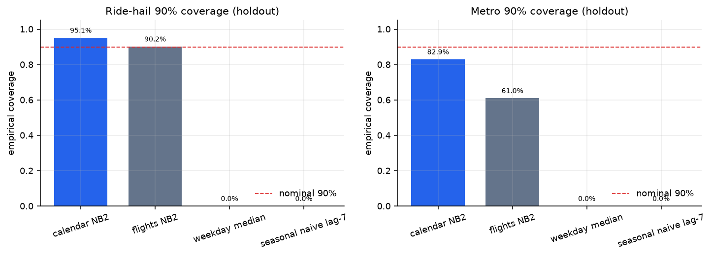

Point baselines have coverage 0 because they emit a point, not an interval.

### 3.3 Copula (ride-hail ↔ metro residuals)

Association after weekday and trend structure. Not a causal effect.

| Quantity          | Value         |
| ----------------- | ------------- |
| Shared dates      | 218           |
| Gaussian copula ρ | 0.749         |
| Split halves      | 0.742, 0.766  |
| 95% CI            | 0.609 – 0.839 |
| Kept              | true          |

Halves agree. The interval excludes 0. The sampler keeps residual coupling.

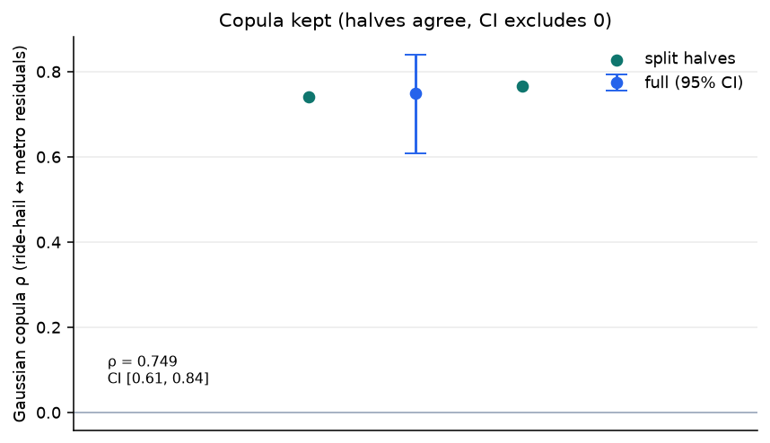

Aviation daily NB2 (context only, not selected as a ride-hail or metro covariate): arrival `phi` 0.566, departure `phi` 2.244. DGCA monthly passenger counts stay context. They do not enter the clocks.

## 4. Layer 3: 1,000,000-row reconstruction

`make amplify ROWS=1000000 SEED=42` after ADR-0013. Bundle `resampler-1.0.0`, hash `2e07bbba7f2c46b3121f176165dd45e2ba42bba81bc58be149f49d4b2f8ddd0b`. One part, sha256 `cac1d92066b70761ffd95b6ca6215a76c749fafa2a55feef27d7cba5d4da18ba`. Two seed-42 runs on the same bundle were byte-identical before the thin-window rewrite. Replay equality is also a pytest.

Natural row mass in the alignment window (used for mode budgets):

| Mode                | Natural rows | Window days with mass                  |
| ------------------- | ------------ | -------------------------------------- |
| Ride-hail activity  | 217.8M       | 535 of 536                             |
| Bus GTFS stop calls | 1.54M        | 1 feed date (2026-09-07)               |
| Metro station-hours | 0.70M        | 373                                    |
| Aviation OpenSky    | 0.20M        | 536 (488 with generated mass at N=1e6) |

Event-row mix is ~98.9% ride-hail because that is the source mix. It is not a floor. People-weighted mix is a different question (metro tracker ~298M people vs 0.70M station-hours). That mix is not this corpus.

| Mode      | Generated rows | Generated days | Provenance                                             |
| --------- | -------------- | -------------- | ------------------------------------------------------ |
| Ride-hail | 988,915        | 536 / 536      | synthetic                                              |
| Bus       | 6,996          | 1              | derived (schedule) + synthetic passengers              |
| Metro     | 3,172          | 373            | synthetic (packed station-hours)                       |
| Aviation  | 917            | 488            | observed_proxy 580, synthetic 337 (gap windows)         |
| **Total** | **1,000,000**  |                | synthetic 992,424 / derived 6,996 / observed_proxy 580 |

Ride-hail remainder absorbs bus undershoot so the part has exactly `N` rows.

### 4.1 Overlay: source clocks vs generated

Generated ride-hail is about 1/220 of source volume. The shape of the window matches. Generated timestamps start at 2024-10-26. The source series includes a 2022–2024 ramp that is out of scope.

Bus has no daily clock. The green bar is the GTFS feed date only, flagged `outside_training_window`.

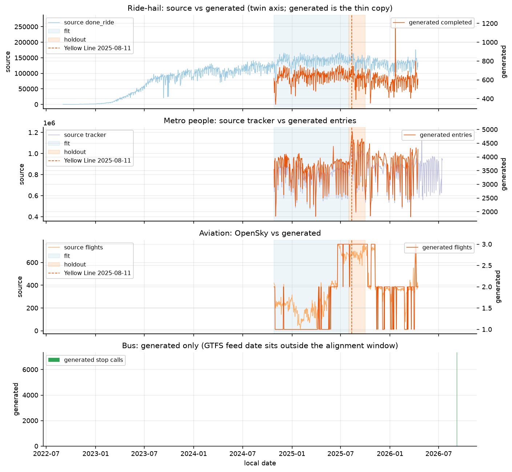

Source-only clocks:

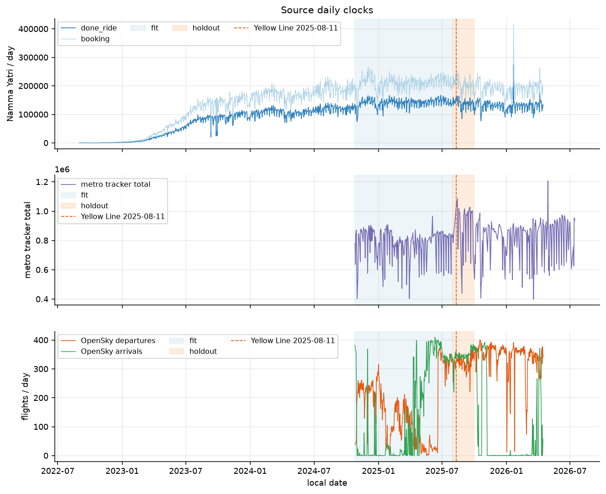

### 4.2 Mode mix (same linear scale)

Total variation between source natural shares and generated shares is ~1e-6. Plot 08 on a log axis previously looked more skewed than the mix is.

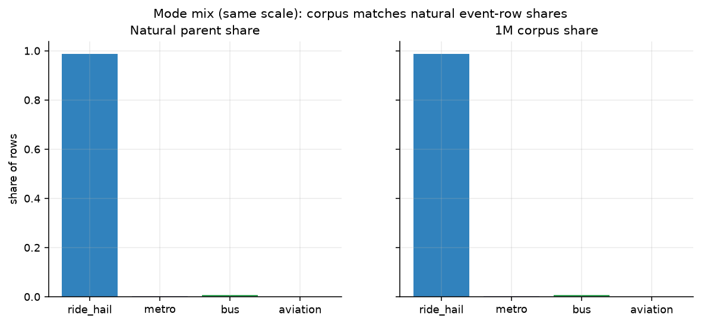

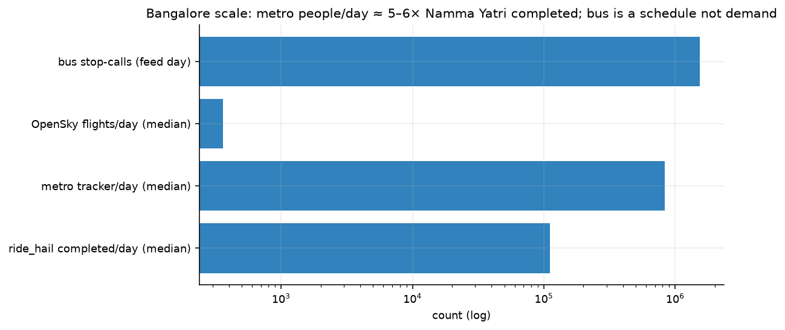

### 4.3 Daily conservation

Each point is one day. Generated ride-hail completed counts stay proportional to source `done_ride`. One high-volume outlier is a real source spike, scaled.

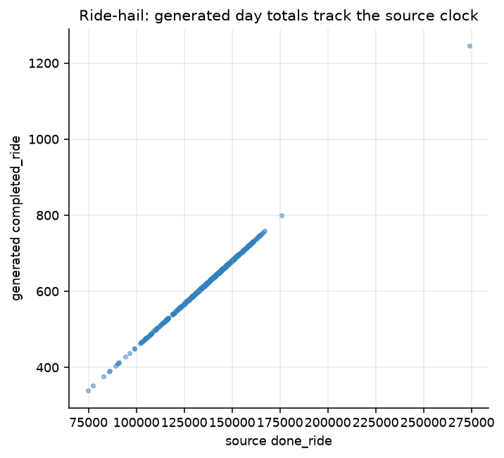

Metro packed people track the tracker. Entries equal exits on 373 / 373 days (1,351,625 people each side on this run).

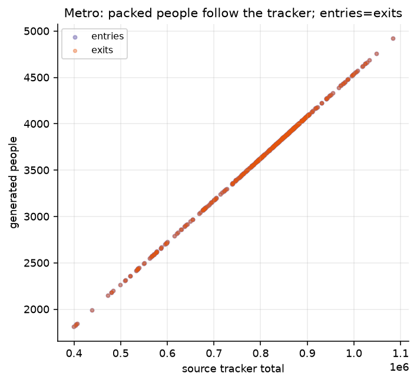

Aviation at N=1e6 is 917 rows over 488 days, so generated counts are 1, 2, or 3 flights per day. Rank order still follows OpenSky volume. Coverage holes stay holes.

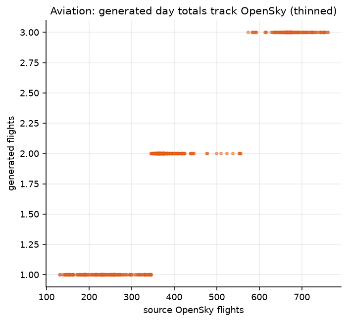

Weekday mix of the corpus now matches the source calendar (Sunday trough). Total variation on weekday shares: 0.022 (was 0.57 when amplify walked three full days).

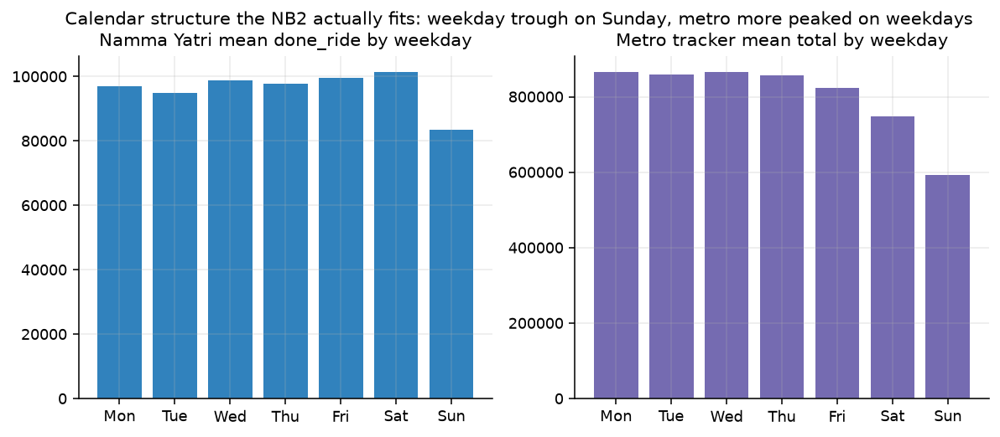

## 5. Copy check (this is not a dump)

The resampler does not copy source rows.

1. Generated ride-hail ids are `fs-` synthetic keys, not Namma Yatri booking ids.
2. Fares are `synthetic_fare_inr` from the earning proxy. They are not observed fares.
3. Hour cells do not match sparse `city_hour` stitch cells. 2026-04-14 has an empty city-hour archive. Generated still has a commute shape.
4. Aviation rows in this run are observed_proxy OpenSky events, subsampled, except 337 synthetic rows. Those 337 sit on day-directions where the OpenSky window failed or was sparse (below half the 75th-percentile day of that direction). A thin window is not emitted as observed_proxy (ADR-0016, ADR-0017). Observed rows keep source ids. They are not a full dump of 201,939 flights.
5. Bus passenger fields are assumption-driven (`ResampleConfig`: 4.6M weekday boardings, capacity 41.3, load 1.4). The timetable is derived.

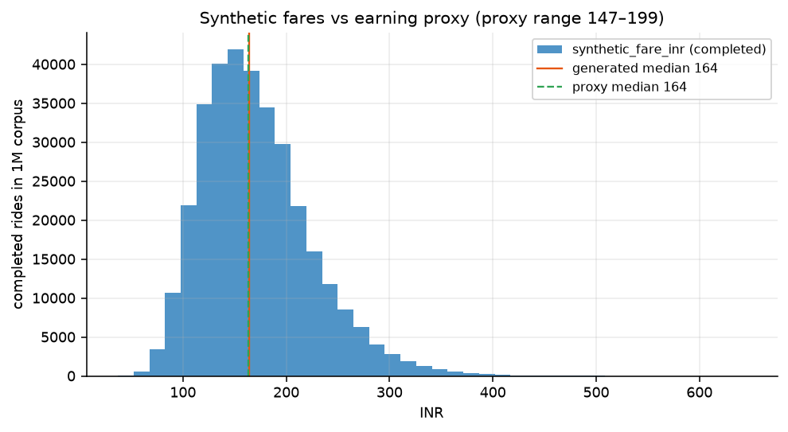

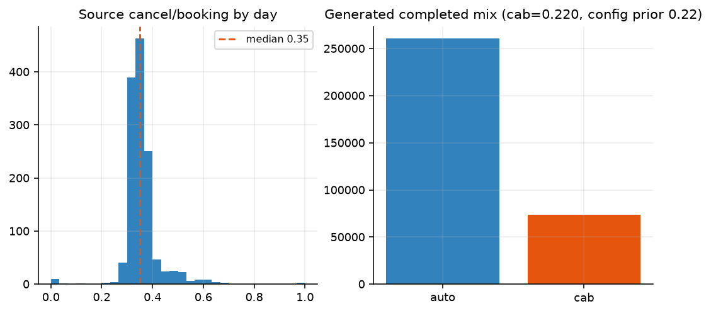

Cab share of generated completed rides is the config prior 0.22, not a measured citywide share.

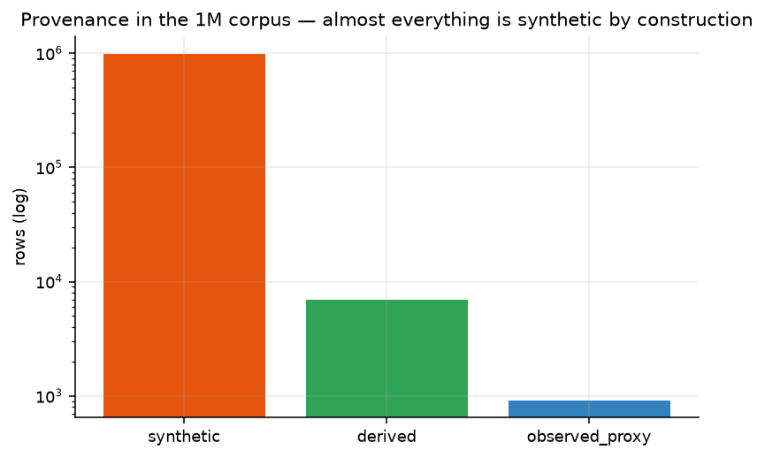

## 6. Hour shapes

Ride-hail generated follows the commute skeleton of the city-hour prior. Night mass at 01:00–03:00 is stronger than the pooled Normal Auto `city_hour` series (~12% at 02:00 vs ~5%). That is the Dirichlet hour profile applied every day. It is not a copy of sparse stitch cells. The hour mean profile was not date-block held out. Treat it as a known bias, not as a pass.

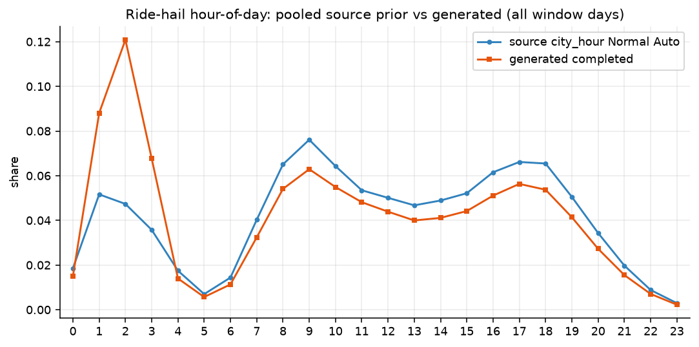

Metro packed cells keep 09:00 / 18:00. Peaks are a bit sharper than RTI because about 8 station-hours per day concentrate people on high-prior cells. Overnight stays dead. The RTI window **is** the Layer 1 hold-out, so metro hour priors are under-validated (plan track B).

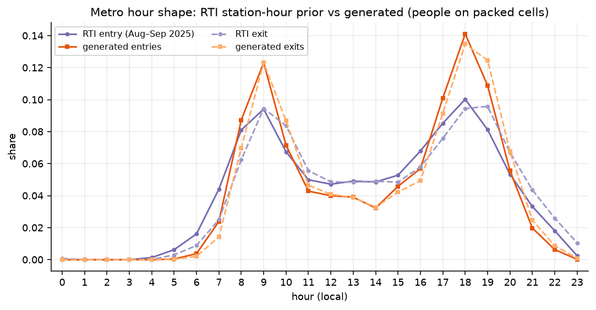

Bus trips are sampled with probability proportional to a metro / ride-hail hour blend. Generated stop-calls therefore diverge from raw GTFS density (TV ~0.18 vs schedule) and pile on 09:00 and 17:00. That is required behaviour, not a defect. Ridership numbers stay #40 synthetic.

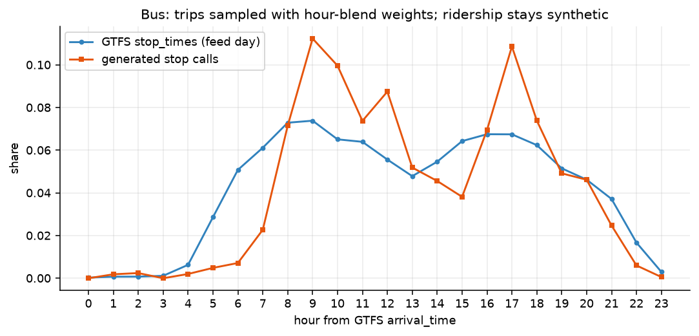

Aviation hour follows OpenSky local time. Generated is a thin subsample.

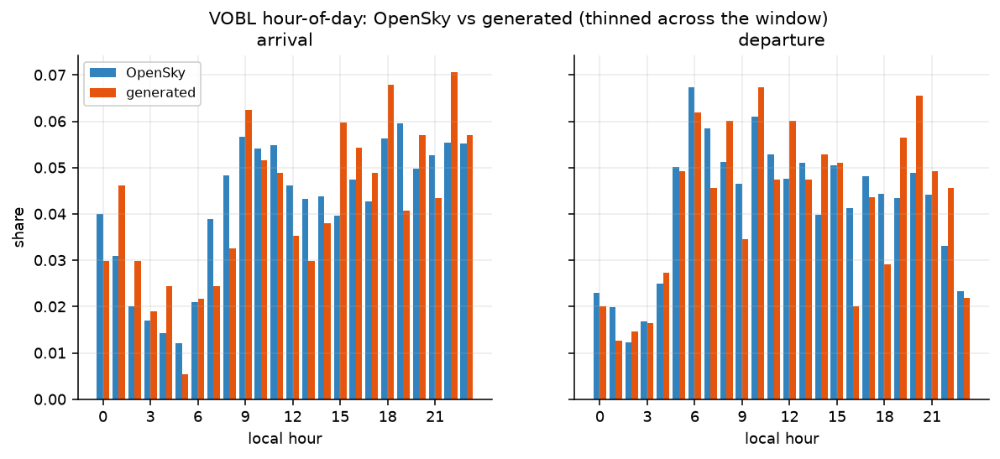

## 7. Tests and software contract

`uv run pytest -q` → 92 passed on 2026-10-22 (e2e slower because the fixture city unfolds ~365 days). `ruff check src tests` clean.

Covered in `tests/test_resample.py`:

- Integer conservation (`largest_remainder`, parent sums).
- Replay equality at a fixed seed.
- Provenance labels (no synthetic marked observed).
- City-independence via `CitySpec` (`testcity` fixture, no Bengaluru literals in builders).
- Thin-window day allocation and metro pack (entries = exits).
- Validator envelope.

## 8. What this report does not claim

| Claim                                                               | Status                                                                                                          |
| ------------------------------------------------------------------- | --------------------------------------------------------------------------------------------------------------- |
| Calendar NB2 beats naive daily baselines on hold-out CRPS           | Supported.                                                                                                      |
| Aviation daily counts improve ride-hail or metro clocks by ≥5% CRPS | Rejected. Terms dropped.                                                                                        |
| Residual ride-hail / metro coupling is stable                       | Supported as association. Not causation.                                                                        |
| Thin 1e6 corpus keeps window calendar and natural mode mix          | Supported on this run.                                                                                          |
| Generated rows are observed trips                                   | Forbidden.                                                                                                      |
| Cab share 0.22 is Bengaluru truth                                   | Uncertain prior from a thin post-2025-06 slice.                                                                 |
| Bus boardings are BMTC ridership                                    | Forbidden. Assumption-driven.                                                                                   |
| Metro hour profile held out on September vs August                  | Not scored. RTI is the clock hold-out.                                                                          |
| Ride-hail hour profile held out                                     | Not scored. Night mass overshoots pooled `city_hour`.                                                           |
| Origin-destination structure                                        | Not modelled. Independent draws.                                                                                |
| Live / wall-clock emit                                              | #39. Amplify timestamps stay inside the alignment window (bus feed date excepted).                              |
| Overfitting of amplify overlay                                      | Reconstruction is tautological by design. Clocks were hold-out scored. Hour mean and metro RTI priors were not. |

## 9. Ticket split

| Ticket          | Owns                                                                                                                                         |
| --------------- | -------------------------------------------------------------------------------------------------------------------------------------------- |
| #34 (this work) | Calibrated resampler, `make amplify`, `make evaluate`, thin-window reconstruction, bus ridership **mechanics** as `ResampleConfig` constants |
| #39             | Kafka producer wall-clock emit, live / historical continuous scale                                                                           |
| #40             | Promote boarding / cab / load constants to `FLOWSTATE_` (ADR-0012)                                                                           |
| #25             | Put the amplified corpus on HDFS                                                                                                             |
| #31             | Scale benches at 1e7 / 1e8                                                                                                                   |

## 10. Source JSON (rounded above)

Exact floats live in [`src/flowstate/benchmarks/results/resampler-evaluation.json`](../src/flowstate/benchmarks/results/resampler-evaluation.json). Schema `resampler-evaluation/1`.
